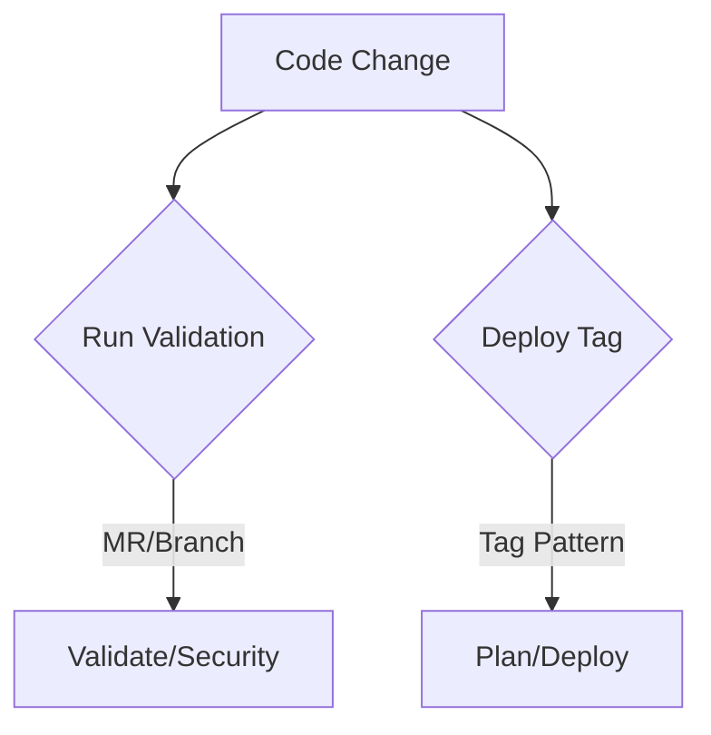

# CI/CD Pipeline Guide

## 1. Overview
Pipeline được thiết kế để quản lý **Infrastructure as Code (IaC)** và **Environment as Code (EaC)** với các tính năng:
- Tự động validate khi có code change
- Triển khai qua tag version (`deploy-<app>-<env>`)
- Thông báo qua Slack/Teams

## 2. Workflow Diagram


## 3. Pipeline Structure

### IaC Repo (Terraform)
| Stage      | Job          | Trigger Condition       |
|------------|--------------|-------------------------|
| validate   | terraform fmt| Merge Request or Push   |
| security   | tfsec scan   | Merge Request or Push   |
| plan       | generate plan| Tag: `deploy-*-*`       |
| deploy     | apply        | Manual from Plan        |

### EaC Repo (ArgoCD)
| Stage      | Job          | Trigger Condition       |
|------------|--------------|-------------------------|
| deploy     | argocd sync  | Tag: `deploy-*-*`       |

## 4. How to Use

### Deploy Application
```bash
# Format: deploy-<application>-<environment>
git tag -a deploy-redis-dev -m "Deploy Redis to Dev"
git push origin deploy-redis-dev
```

### Rollback Changes
```bash
# Revert code then create new tag
git revert <commit>
git tag -a deploy-redis-dev -m "Rollback Redis"
git push --tags
```

## 5. Environment Matrix
| Environment | Branch/Tag Pattern   | Approval Required |
|-------------|----------------------|-------------------|
| Development | `deploy-*-dev`       | No                |
| Staging     | `deploy-*-staging`   | Yes               |
| Production  | `deploy-*-prod`      | Yes               |

## 6. Troubleshooting

### Common Errors
1. **Invalid Tag Format**  
   → Đảm bảo tag theo format: `deploy-<app>-<env>`  
   Ví dụ: `deploy-vault-prod`

2. **Deployment Failed**  
   → Kiểm tra logs pipeline  
   → Verify ArgoCD sync status (với EaC)

3. **Permission Denied**  
   → Kiểm tra CI/CD variables đã set đủ  
   → Verify RBAC permissions

## 7. Best Practices
- Luôn tạo Merge Request trước khi deploy
- Test kỹ ở môi trường dev/staging
- Review kế hoạch Terraform trước khi apply
- Giữ tag name rõ ràng, có ý nghĩa

## 8. Contact
| Role        | Slack Channel     |
|-------------|-------------------|
| SRE Team    | #sre-support      |
| DevOps      | #devops-alerts    |